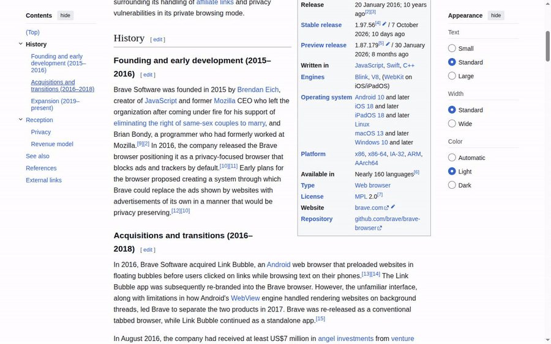

# brave-cdp

[English](README.md) | **Português (Brasil)**

Skill do Claude Code para controlar um **Brave isolado** (perfil temporário próprio, CDP + Playwright) em qualquer tarefa web, sem tocar no navegador do dia a dia.



A demo foi deixada lenta de propósito (digitação, pausas e sobreposições) para cada passo ficar visível. As chamadas
reais levam de dezenas a poucas centenas de milissegundos; cada uma é uma chamada `node run.mjs` a um broker que mantém o navegador aberto:

| Ação | Mediana | Melhor |
|---|---|---|
| `start.sh` (abrir o navegador do zero) | 1,13 s | 1,13 s |
| Chamada vazia (ida e volta do `run.mjs`) | 22 ms | 20 ms |
| `goto` página local | 361 ms | 353 ms |
| `goto` página real (artigo da Wikipedia) | 675 ms | 656 ms |
| `goto` mesma página, `wait: 0` (sem esperar estabilizar) | 128 ms | 123 ms |
| `text()` (4000 caracteres desse artigo) | 35 ms | 27 ms |
| `styles()` | 53 ms | 47 ms |
| `clickables()` | 47 ms | 39 ms |
| `click` num botão | 363 ms | 354 ms |
| `shot()` da área visível | 85 ms | 81 ms |
| `shot({ selector })` de um elemento | 73 ms | 67 ms |

Brave 1.95 headless num Intel Core Ultra 5 125U, 10 execuções por ação. `goto` e `click` incluem a espera até a página
estabilizar (carregada, rede e DOM parados por 300 ms): apps renderizados no cliente têm tempo de terminar e páginas
estáticas voltam rápido. Rode `node test/bench.mjs` para medir na sua máquina.

Instruções de uso para o agente: [`SKILL.md`](SKILL.md).

## Instalação

### Como plugin (recomendado)

No Claude Code:

```
/plugin install brave-cdp --marketplace iudizm/brave-cdp
```

Em versões anteriores à 2.1.275, adicione o marketplace antes: `/plugin marketplace add iudizm/brave-cdp`, depois
`/plugin install brave-cdp@brave-cdp`. O Claude Code instala o `playwright-core` sozinho (precisa do `npm` no `PATH`).
O Claude usa a skill quando uma tarefa precisa de navegador; você também pode chamá-la com `/brave-cdp:brave-cdp`.
Versões novas chegam com `claude plugin update brave-cdp@brave-cdp`, ou sozinhas se você ativar o auto-update do marketplace no `/plugin`.

### Como skill avulsa

```bash
git clone https://github.com/iudizm/brave-cdp.git ~/.claude/skills/brave-cdp
cd ~/.claude/skills/brave-cdp && npm ci
```

Se preferir clonar em outro lugar, crie um symlink: `ln -s "$PWD" ~/.claude/skills/brave-cdp` (de dentro do clone).
Para atualizar, `git pull && npm ci`. Use o plugin ou o clone, não os dois: se ambos existirem, vale o plugin.

### Requisitos

**Linux**, Node 20+ e Brave (ou Chromium / Chromium do Playwright como fallback).
Os scripts usam `setsid` e `flock` (util-linux) e `realpath` (coreutils); gravar demos em GIF/MP4/WebM requer `ffmpeg`.
Navegadores instalados via **snap** não funcionam (têm `/tmp` privado) e são ignorados; use o pacote
.deb/.rpm do Brave ou o Chromium do Playwright (`npx playwright-core install chromium` na pasta da skill).

## Uso rápido

O Claude roda isso por você. Para testar à mão, de dentro da pasta da skill (o clone, ou o caminho que
`claude plugin list --json` mostra em `installPath`):

```bash
scripts/start.sh
node scripts/run.mjs -e 'await goto("https://example.com"); return text({max: 1500})'
scripts/stop.sh --clean
```

Para conferir a instalação (ou uma mudança), rode `test/smoke.sh`: ele usa uma página local numa instância descartável e limpa tudo no fim.

## Segurança

O brave-cdp é feito para uso **supervisionado**: você acompanha a sessão e aprova o que o agente faz pelos prompts de
permissão normais do Claude Code. Ele fecha os caminhos fáceis para escapar dessa supervisão, mas não consegue, sozinho,
tornar seguro um agente que lê páginas web não confiáveis.

- `run.mjs` executa JavaScript arbitrário em Node com as permissões do seu usuário (é o propósito da skill), e o
  `start.sh` executa o que `BROWSER_BIN` apontar. Liberar qualquer um dos dois no allowlist do Claude Code equivale a
  liberar execução arbitrária de código: aprove essas chamadas uma a uma, ou libere só em sandboxes descartáveis.
- Páginas podem conter prompt injection. O `SKILL.md` instrui o agente a tratar o conteúdo das páginas como dado, nunca
  como instrução, mas isso é mitigação, não garantia: fique de olho em ações que você não pediu.
- Nenhuma porta CDP é aberta: um broker (`server.mjs`) segura o navegador via pipe e atende o `run.mjs` num socket Unix
  dentro de `/tmp/claude-brave-<uid>/` (modo 0700), então outros usuários locais não conseguem controlar o navegador.
  O sandbox do Chromium continua ligado (o Playwright o desligaria por padrão).
- Com perfil persistente (`PROFILE=nome`) e sessões logadas, o agente age como você nesses sites. Use só quando
  precisar. Perfis persistentes só podem ficar em `~/.local/share/brave-cdp/profiles/`, então o navegador nunca pode
  ser apontado para o perfil do seu navegador do dia a dia.
- Como qualquer navegador, ele alcança `localhost` e a sua rede local. O `grepScripts()` ignora scripts em hosts
  privados, a menos que a própria página seja local.
- Perfis temporários, logs, screenshots e o socket ficam em `/tmp/claude-brave-<uid>/`; `stop.sh --clean` os remove.

## Licença

[MIT](LICENSE)
